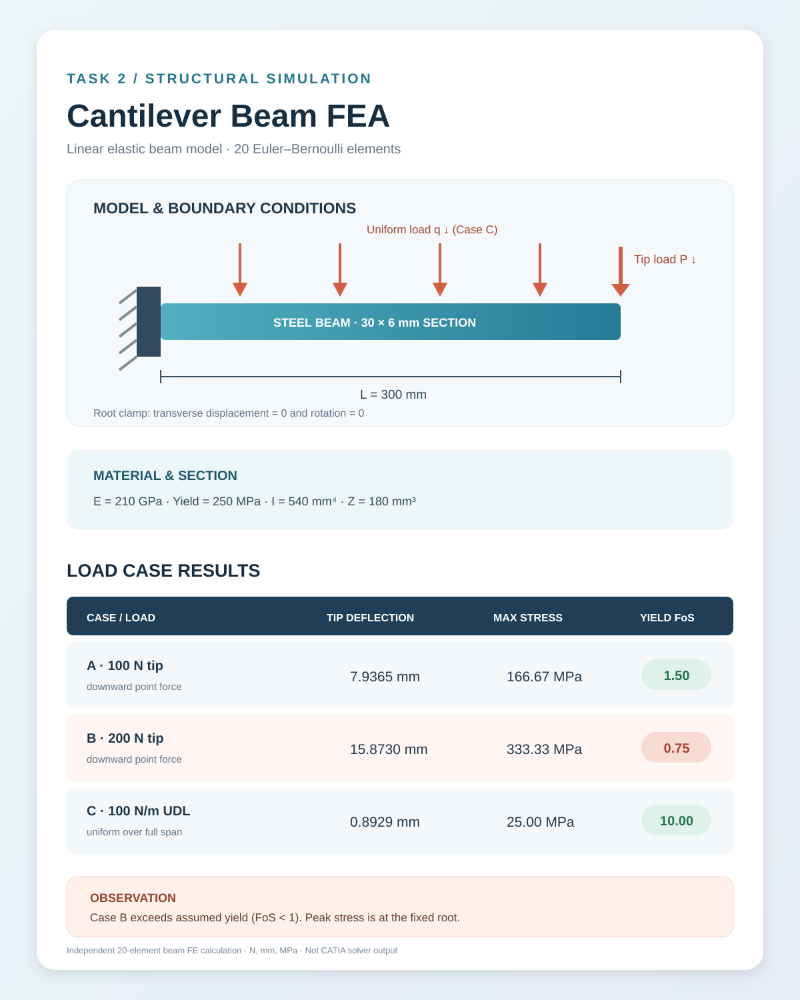

# CodeAlpha Tasks

CATIA V5 mechanical design and structural simulation submissions.

## Task 1 — Connecting Rod Assembly

Native CATIA V5 assembly and component files:

- [Main assembly product](Task1_Connecting_Rod/CONNECTING%20ROD.CATPart.CATProduct)
- [Connecting rod](Task1_Connecting_Rod/CONNECTING%20ROD.CATPart)
- [Big-end cap](Task1_Connecting_Rod/BIG%20END%20CAP.CATPart)
- [Bolt](Task1_Connecting_Rod/BOLT8.CATPart)
- [Nut](Task1_Connecting_Rod/NUT.CATPart)

Download all five files together, extract them into one folder, then open the `.CATProduct` in CATIA V5 so its component links can resolve.

## Task 2 — Structural Simulation (FEA)

A cantilever beam was analyzed for three loading cases. The report includes the model, boundary conditions, material assumptions, results, and observations.

- [Simulation report](Task2_Structural_FEA/structural_fea_report.html)
- [Numerical results](Task2_Structural_FEA/fea_results.csv)
- [Reproducible beam-FE source](Task2_Structural_FEA/fea_beam.js)
- [Task 2 package ZIP](Task2_Structural_FEA/task2_structural_fea_submission.zip)

**Analysis note:** The report’s numeric results come from an independent 20-element Euler–Bernoulli beam FE model, not from the CATIA structural solver. A CATIA V5 macro for building the matching beam solid is included in the Task 2 folder.
